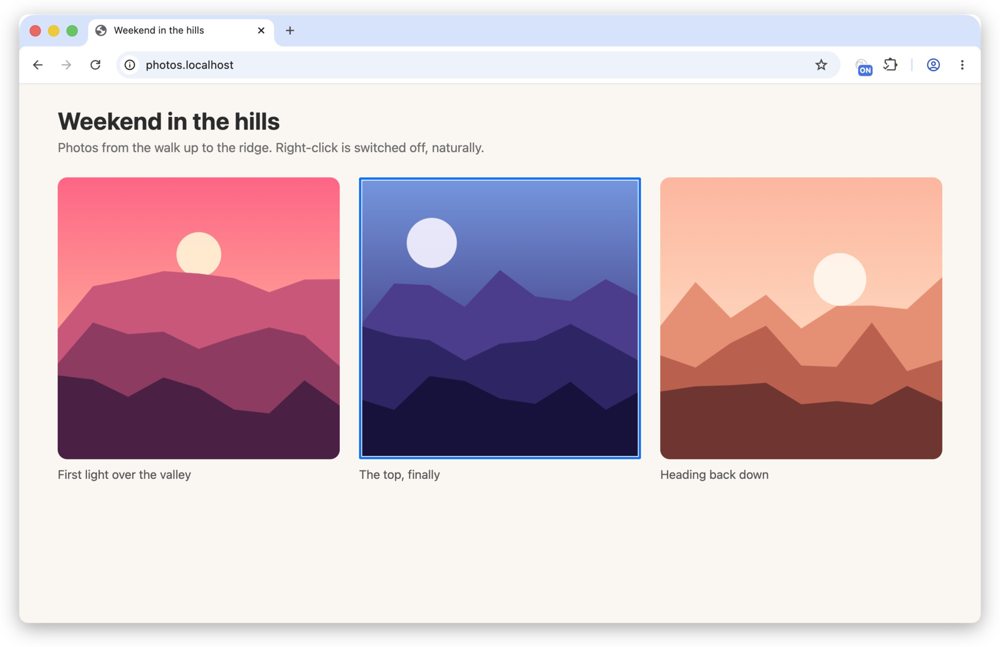

# Download Any Image Chrome Extension 🖼️

One button in your Chrome toolbar. Click it, then click any picture on the page, and that picture lands in your downloads folder. No right-click menu roulette, no "Save image as..." greyed out because the site hid the photo behind an invisible div. Click, click, done.

Other "image under cursor" extensions make you hover over the picture and then go hunting in a menu, by which time the mouse has wandered off. Here the click on the page _is_ the pick. 🎯



## What you get 🪄

- **Pictures that refuse to be right-clicked.** It looks through transparent overlays, so the photo under that annoying invisible layer is still yours.
- **Every way a page can show a picture:**
  - plain ``, including `srcset` and `<picture>` (you get the version the browser actually picked)
  - CSS backgrounds, on the element or any element behind it, `::before` and `::after` included
  - `image-set()` (it takes the sharpest one), `mask-image`, `content: url()` and `list-style-image`
  - `<canvas>`, so whatever JavaScript drew comes out as a PNG
  - inline `<svg>`, saved as a proper `.svg` file
  - SVG `<image>`, `<input type="image">` and a `<video>`'s poster
  - `blob:` URLs, which only exist inside the page, read out of it and saved
  - pictures inside open shadow DOM, and ones with `pointer-events: none`
- **Layered backgrounds** pick the topmost real picture and skip the gradients.
- **Images from other sites** download fine, with your cookies, as if you'd opened them yourself.
- **Good names.** If the picture had a real name on the server (`sunset-over-the-bay.jpg`), you keep it. If it was called `IMG_8a7f6c5d4e3b...` or nothing at all, it gets the date, the time and the page title instead, like `2026-10-30-14-05-my-cool-page.png`. The extension always matches what the file really is, so a "`.jpg`" that's secretly a WebP comes out as `.webp`.

## Install it 🔧

It's on the [Chrome Web Store](https://chromewebstore.google.com/detail/jgfdiolaicdckcanemgipkcoljlimffe). Hit **Add to Chrome**, then click the puzzle piece 🧩 in the toolbar and pin **Christian's Download Any Image**. Chrome keeps it up to date for you.

### Or build it yourself 🛠️

You need [Node.js](https://nodejs.org) 22 or newer, and Chrome 126 or newer.

1. Grab the code and build it:

   ```bash
   git clone https://github.com/christianjbrown/chrome-extension-download-any-image.git
   cd chrome-extension-download-any-image
   npm ci
   npm run build
   ```

   That makes a `dist` folder, which is the actual extension.

2. Open `chrome://extensions` in Chrome.
3. Flip on **Developer mode** (top right).
4. Click **Load unpacked** and pick the `dist` folder.
5. Click the puzzle piece 🧩 in the toolbar and hit the pin next to **Christian's Download Any Image**.

#### Updating a build 🔄

```bash
git pull
npm ci
npm run build
```

Then hit the reload arrow on the Christian's Download Any Image card in `chrome://extensions`.

## Using it 🖱️

1. Click the button. It shows a blue **ON**, the cursor turns into a crosshair, and a blue frame follows whatever picture is under the pointer.
2. Click the picture. It's in your downloads folder.

Changed your mind? Click the button again, press **Escape**, or click on something that isn't a picture. That click is eaten, so you don't accidentally follow a link while trying to cancel. 🍽️

## Good to know 🤓

- **The click belongs to the extension.** While it's armed, the page never sees your click, so links don't open and buttons don't fire.
- **The page's own wallpaper is ignored.** A background on the whole page (`<body>` or `<html>`) never gets picked, so clicking on text just cancels.
- **Tainted canvases** (a canvas with another site's picture painted on it) are locked by the browser itself, and nobody can read them back. You'll get a red `!` saying so.
- **Embedded frames from other sites** are off limits: the button only lets the extension into the page you clicked it on.
- **Chrome's own pages** (`chrome://` anything, the Web Store) are off limits to every extension. Red `!` again.
- **Getting a save dialog every time?** That's Chrome's **Ask where to save each file before downloading** setting. Turn it off in `chrome://settings/downloads`.
- **A red `!` on the button** means something went wrong. Hover over it and the tooltip says what.
- **It asks for three permissions:** `activeTab` and `scripting` to put the picker into the tab you clicked on (and only that tab, only when you click), and `downloads` to save the file. No access to any other site.

## No tracking 🔒

No analytics, no tracking, no ads, no accounts, and nothing phoning home. The only thing it ever fetches is the image you clicked, from wherever the page got it, and that goes straight into your downloads folder.

## Development 🛠️

It's TypeScript, bundled with esbuild, tested with Vitest.

```bash
npm test          # the unit tests
npm run ci        # everything CI checks: format, lint, types, unused code, 100% coverage, build
```

`npm run ci` is exactly what CI runs, and coverage has to stay at 100% for lines, branches, functions and statements, or it fails. To run it before every push, point git at the committed hook: `git config core.hooksPath .githooks`.

How it fits together, in `src`:

- **`background/`** is the service worker. A toolbar click asks the tab whether it's armed, and either disarms it or injects the page script and the crosshair. When the page reports a pick, it downloads the image and names it once Chrome knows the file's type (`filename-suggester.ts`).
- **`page/`** is the script injected into the page. `pick-session.ts` waits for the click, `point-hits.ts` lists what's under it, `image-locator.ts` asks each finder in turn, and `image-readers.ts` turns the picture into something the service worker can download.
- **`shared/`** is the messages the two send each other, with a shape check for every one.

Each way of finding a picture is its own small class (`element-finders.ts`, `css-finder.ts`), handed to the locator as a list, so teaching it a new trick means adding a class. Each context's `main.ts` is the only file that touches `chrome`, `window` or `document`; everything else gets its collaborators through its constructor, behind an interface, and is tested on its own with fakes.

## Licence 📄

MIT. See [LICENSE](LICENSE).
